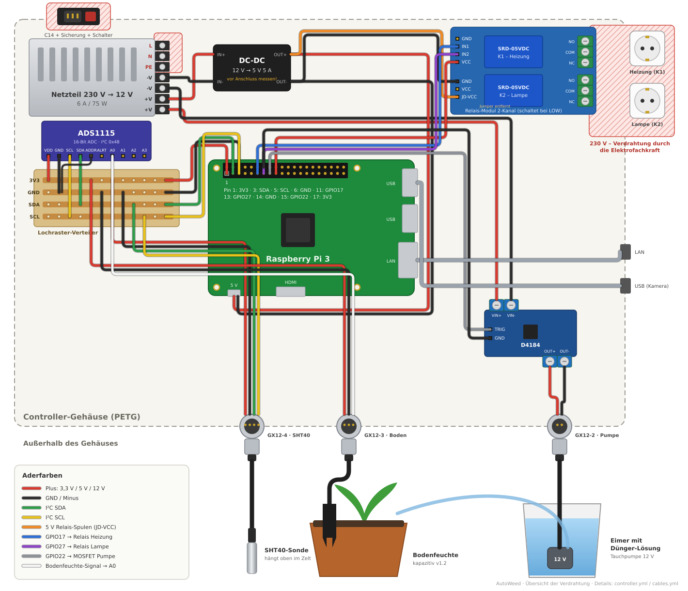

# AutoWeed

Automatisierte Steuerung für ein Grow-Zelt: Temperatur, Bodenfeuchtigkeit und Lichtzyklus werden überwacht und geregelt, konfiguriert über eine WebUI.

- **Board** (Raspberry Pi 3): liest die Sensoren, schaltet Heizung, Lampe und Pumpe und regelt eigenständig weiter, auch wenn der Server ausfällt.
- **ECS** (Home-Server): WebUI, Konfiguration, Messdaten-Historie (InfluxDB) und Benachrichtigungen (ntfy).



## Dokumentation

| Datei | Inhalt |
|---|---|
| [docs/vision.md](docs/vision.md) | Ziele und Anforderungen |
| [docs/architecture.md](docs/architecture.md) | Architektur, API, Fail-Safe-Matrix, Deployment |
| [docs/partslist.md](docs/partslist.md) | Teileliste |
| [docs/roadmap.md](docs/roadmap.md) | Arbeitsstand |

## Aufbau des Repos

```
crates/shared   API-Typen (auch als TypeScript für das Frontend)
crates/board    Board-Software
crates/ecs      ECS-Backend
frontend        WebUI (React, Vite, TypeScript)
hardware/wiring Verdrahtungspläne (WireViz)
deploy          Compose-Dateien für Portainer
docs            Dokumentation
```

## Entwicklung

```bash
cargo run -p autoweed-board        # Board-API auf :8080
cargo run -p autoweed-ecs          # ECS-Backend auf :3000
cargo test -p autoweed-shared      # erzeugt frontend/src/generated/*.ts
cd frontend && npm install && npm run dev
```

## Lizenz

[AGPL-3.0](LICENSE)
