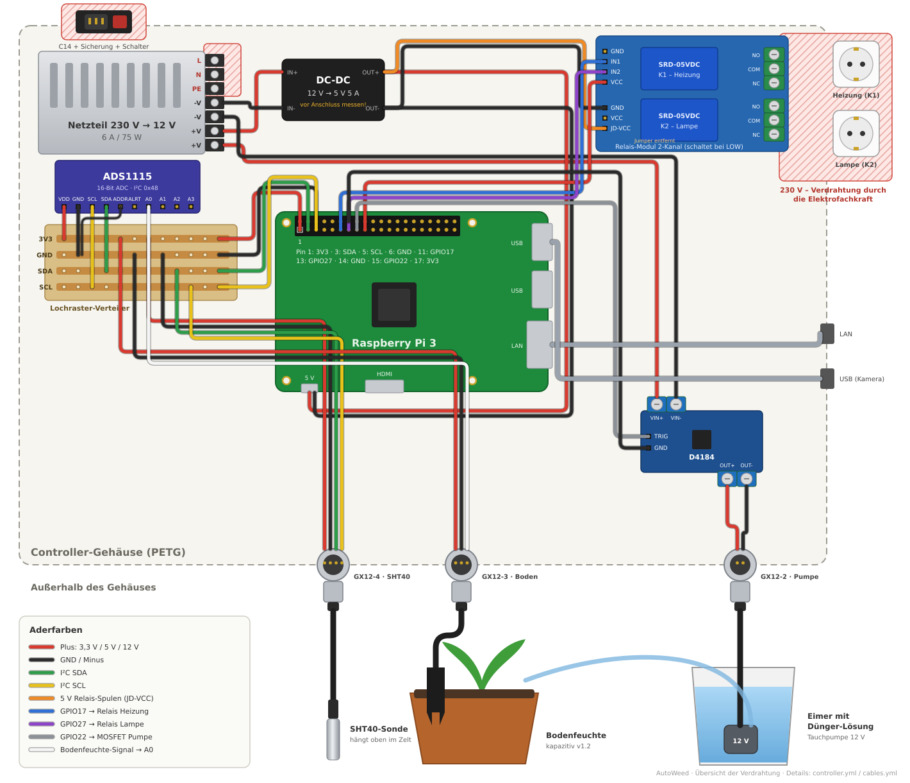

# Verdrahtungspläne



| Datei | Inhalt |
|---|---|
| [overview.py](overview.py) → [overview.svg](overview.svg) | Übersicht im Steckplatinen-Stil (oben). Bauteile und Kabel sind von Hand platziert; nach Änderungen `python3 overview.py overview.svg` ausführen und beides committen. |
| [controller.yml](controller.yml) | Verdrahtung im Controller-Gehäuse: Netzteil, DC-DC-Wandler, Pi, ADS1115, Relais, MOSFET, GX12-Buchsen |
| [cables.yml](cables.yml) | Externe Kabel: SHT40, Bodensensor und Pumpe zu den GX12-Steckern |

Die Pläne sind [WireViz](https://github.com/wireviz/WireViz)-Dateien. GitHub Actions rendert sie bei jedem Push auf `main` (Artefakt `verdrahtung` im Lauf „Build“) und hängt SVG, PNG, HTML und Stückliste (TSV) sowie die Übersicht an jedes Release.

Die verbindliche Pinbelegung steht in den YAML-Dateien. Ändert sich dort etwas, muss die Übersicht in `overview.py` mitgezogen werden.

Die 230-V-Seite ist nur als Anschlussblock eingezeichnet. Wie Netzteil-Eingang, C14-Buchse, Schuko-Dosen und Relaiskontakte verdrahtet werden, legt die Elektrofachkraft fest.

Lokal rendern (optional, braucht Graphviz):

```bash
sudo pacman -S --needed graphviz
pipx install wireviz
wireviz -o /tmp/wiring hardware/wiring/controller.yml
```
